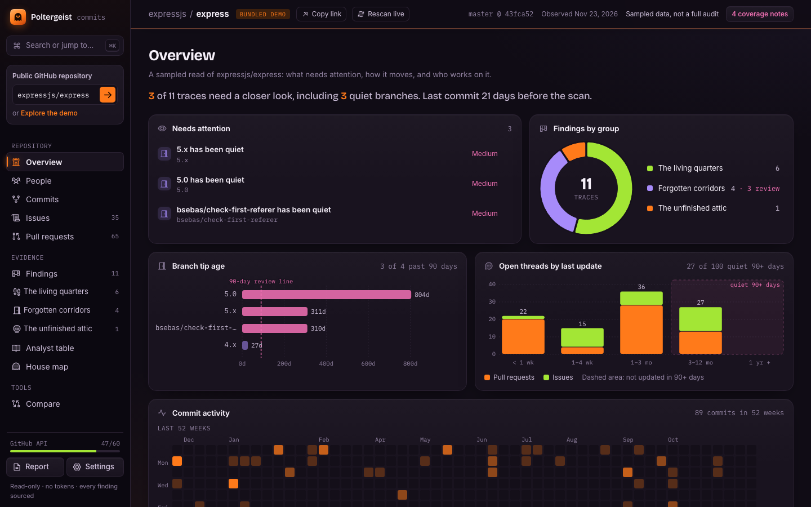
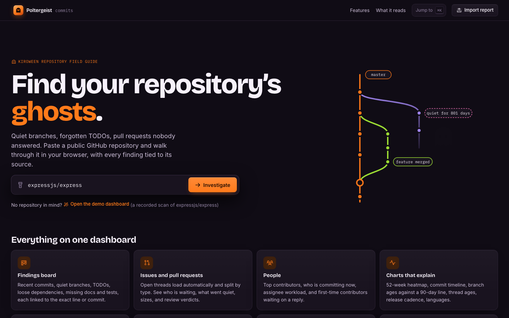
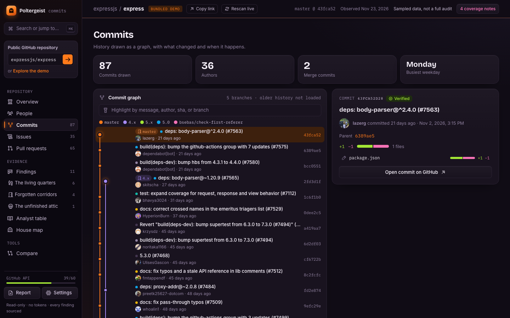
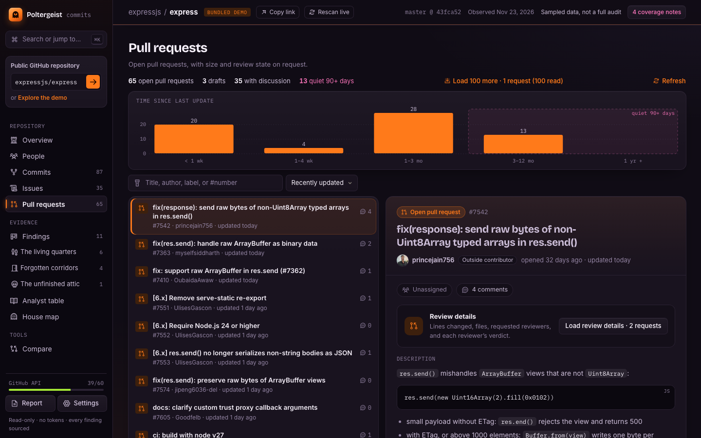
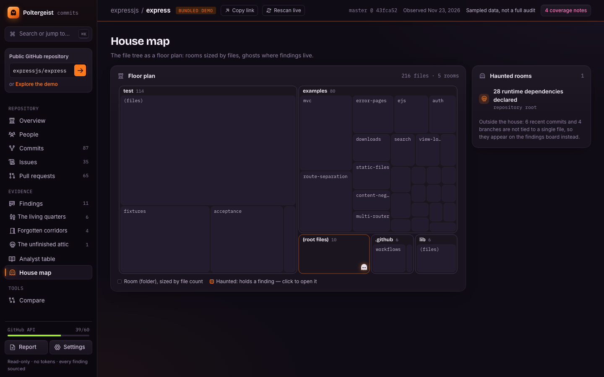
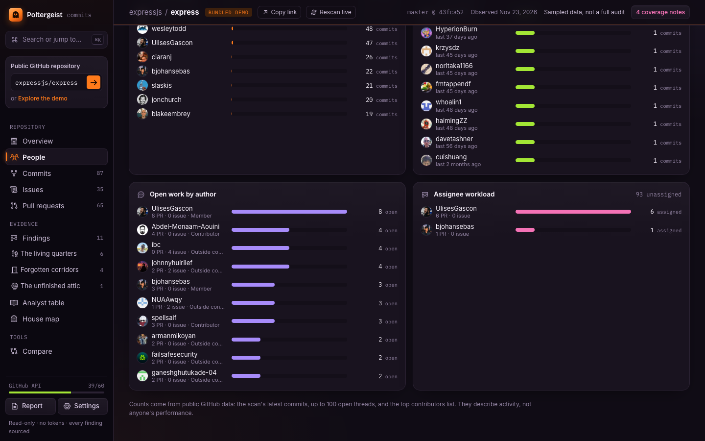
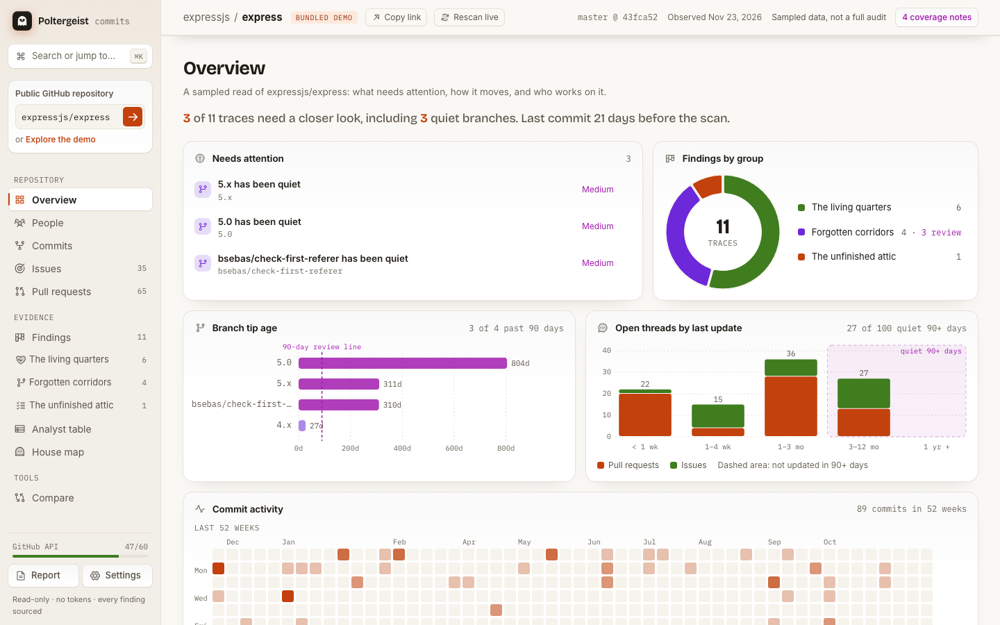

# Poltergeist Commits

**A haunted field guide to any public GitHub repository.** Find quiet branches, forgotten TODOs, pull requests nobody answered, and who is actually working on the code — in your browser, with every finding tied to the exact line or commit it came from.

**Live site:** https://rishiishah.github.io/Kiroween/ (published by the GitHub Pages workflow; see [Deploy](#deploy)) · Built for **Kiroween** with [Kiro](https://kiro.dev).



| | |
|---|---|
|  |  |
|  |  |
|  |  |

## Run it

Requires Node.js 22.22.2+, 24.15+, or 26+.

```sh
npm ci
npm run dev        # http://127.0.0.1:5173
npm test           # 120+ unit, property, and UI tests
npm run build      # type-check + static build into dist/
npm run preview    # serve the build on :4173
```

Open the home page and choose **Open the demo dashboard** (a recorded scan of `expressjs/express`), or type any public `owner/repo`.

## What it does

**Home → dashboard.** The home page explains the tool, offers the demo, and lists recent scans ("Pick up where you left off"). The dashboard has:

- **Overview** — a one-line verdict, *Needs attention*, findings-by-group donut, branch tip ages against a 90-day review line, open-thread age histogram, 52-week commit heatmap, commit timeline, people preview, release cadence, newest threads, languages, repository facts, and coverage notes.
- **People** — all-time top contributors, who authored the latest commits, open work per author (with their relationship: owner, member, contributor, first-timer), assignee workload, who opens pull requests, and first-time contributors waiting longest.
- **Commits** — a GitHub-style lane graph of the default branch and sampled branches with merges, branch labels, avatars, and commit types; select a commit to see every changed file with change bars. Plus a commit-type donut, a weekday × hour punch card, and weekly code frequency.
- **Issues / Pull requests** — loaded automatically and split by type, with search, sorting, a time-since-update chart, *Load 100 more*, Markdown-rendered descriptions and comments, and on-demand PR review details (size, files, reviewers, verdicts).
- **Findings board & Analyst table** — recent commits ("living quarters"), quiet branches ("forgotten corridors"), and TODOs, loose dependencies, missing docs/tests, sensitive file names ("the unfinished attic"). Each opens an evidence pane with source link, confidence, and next step, plus revision-specific review notes.
- **House map** — the file tree as a floor plan: folders are rooms sized by file count; ghosts mark rooms holding findings. Click a haunted room to open its evidence.
- **Compare** — put another public repository side by side (stars, forks, open threads, findings, quiet branches, branch age, commit pace, files) in a butterfly chart.

**Also:** ⌘K / Ctrl+K command palette for every view, finding, thread, action, and theme · **J/K** through findings, **Esc** to close · shareable deep links (`#/dashboard?repo=owner/name&view=commits`) with **Copy link** · six themes (Halloween default, Light, Dark, Midnight, High contrast, Match system) with theme-specific icon sets · report export/import, same-repo snapshot comparison, Markdown summary, print/PDF · opt-in synthesized ambience · subtle motion that honors reduced-motion settings.

## Three-minute demo script

1. **Home** → *Open the demo dashboard*. Point out the verdict line and *Needs attention*.
2. Click the longest bar in **Branch tip age** → the evidence pane shows a branch quiet for 800+ days, its source commit, and a suggested next step.
3. **House map** → rooms sized by files; the ghost marks where a finding lives. Click it.
4. **Commits** → the lane graph; click a merge commit to see its files and change bars. Scroll to the punch card.
5. **Pull requests** → open one: rendered Markdown, author relationship, *Load review details*.
6. **People** → first-time contributors waiting longest.
7. Press **⌘K**, type a finding or "theme", switch to **Light**; then **Copy link** to share the exact view.

## GitHub quota and privacy

Unauthenticated GitHub allows **60 REST requests per hour per IP**. The app is built around that:

- **A scan costs at most 8 REST calls.** Up to six source files are read from `raw.githubusercontent.com` (pinned to the scanned commit), which does not count toward the API quota.
- **45-minute response cache** (IndexedDB) for every GitHub read. Revisiting a repository, reloading, or reopening the demo costs **0** requests. Only HTTP 200 responses are stored; errors, rate limits, and "still computing" replies never are. The header shows **FROM CACHE**; *Rescan live* and every *Refresh* skip it; *Settings → Clear cached GitHub data* empties it.
- **Shared URLs**: the scan and the commit graph request identical URLs, so opening Commits after a scan reuses them.
- **Spent-quota guard**: once GitHub reports zero remaining, no further API requests are sent until the reset time (remembered across reloads) and the UI says when to retry. The meter reads the free `/rate_limit` endpoint.
- **Background budget**: automatic loads (threads 1 request, details 4, commit graph ≤ 5, statistics 2) run only if they leave **10 requests for scans**, counting only uncached URLs; otherwise the panel explains the pause.
- **Optional token** (*Settings → GitHub access*): raises the limit to 5,000/hour. Held in memory for the current tab only, never saved, exported, or logged, and sent only to `api.github.com`. Private repositories are still refused.

Typical first visit to a new repository: scan 8 + threads 1 + details 4 + statistics 2 ≈ **15 requests**; repeats within 45 minutes: **0**.

Privacy and safety: no server, no analytics, no accounts. Repository text is always rendered as text; Markdown is rendered as React elements with raw HTML skipped, only http(s) links, and images shown as links (no third-party image loads). GitHub links are built from validated numbers, shas, and logins; avatars from validated numeric ids with no referrer. Repository code is never executed and nothing is written to GitHub.

## What the scan reads and claims

The scan reads metadata, the default branch's latest commits (analysis uses 20), the first page of branch names, up to four non-default branch histories (for tip dates), a recursive tree (≤ 2,000 files), and up to six source files (≤ 64 KiB each; root `package.json` first, then `src/`, `lib/`, `app/`). Evidence is pinned to the inspected revision; branch evidence to each observed tip.

- Branch tips ≥ 90 days old get a medium-confidence review suggestion — age does not prove abandonment.
- TODO/FIXME markers are text observations (max three per file), not confirmed bugs.
- Dependency declarations flag broad or remote version strings without claiming vulnerabilities.
- Missing README and "no recognized tests" are medium-confidence and only reported for complete trees.
- Sensitive file names (`.env`, `*.pem`, `id_rsa`) are flagged without reading contents or claiming secrets.
- No findings does not mean no problems; coverage notes always list what was sampled.

## Deploy

**GitHub Pages (configured):** `.github/workflows/deploy.yml` runs tests, builds, and publishes `dist/` on every push to `main`. One-time setup: *Repository → Settings → Pages → Build and deployment → Source: GitHub Actions*. The build uses relative asset paths, so it works under `/Kiroween/`.

**Cloudflare Pages (alternative, free):** build command `npm run build`, output directory `dist`.

## Architecture

| File | Responsibility |
|---|---|
| `src/scan.ts` | Snapshot model, input validation, bounded scan, evidence mapping |
| `src/apiCache.ts`, `src/quota.ts`, `src/token.ts` | Response cache, quota tracking/guard, optional in-memory token |
| `src/community.ts`, `src/history.ts`, `src/useCommunity.ts` | Threads, details, PR reviews, commit graph data and lane layout, budgeted loading |
| `src/App.tsx` | Shell, routing and deep links, sidebar, evidence pane, menus, palette |
| `src/Overview.tsx`, `People.tsx`, `Commits.tsx`, `Issues.tsx`, `House.tsx`, `RepoCompare.tsx`, `Home.tsx` | Views |
| `src/charts.tsx` | SVG charts (d3-scale/shape/array): donut, bars, histograms, heatmap, timelines, punch card, code frequency |
| `src/RichText.tsx` | Safe GitHub-flavored Markdown |
| `src/ui.tsx`, `src/theme.ts` | Theme-aware icons, custom logo, motion pace, themes |
| `src/reviews.ts`, `src/compare.ts`, `src/markdown.ts` | Review notes, report import/export, snapshot comparison, Markdown summary |

Heavy pieces load on demand: animation engine, command palette, and Markdown renderer.

## Verification

- `npm test` — 120+ Vitest tests with fast-check properties: URL boundaries, deterministic evidence mapping, scan bounds and raw sampling, cache TTL/purge/blocking, quota persistence, commit-graph layout (every commit once, children before parents, deterministic), Markdown safety (no HTML, no `javascript:` links, images as links), token scoping, deep links, house-map placement, comparison metrics, and UI flows.
- `npm run screenshots` — Playwright captures every screen across themes and mobile (start `npx vite preview --port 4178` first). GitHub responses are recorded once to `.screens/github.har` and replayed, so visual QA costs no quota.
- `npm run a11y` — axe-core (WCAG 2.1 AA) on 10 screens × 5 themes; currently **0 serious or critical issues**.
- `npm run build` — strict TypeScript type-check and production build.

## Kiro workflow

- **Spec-driven:** `.kiro/specs/repository-analysis/` holds requirements, design, and the task checklist that tracked every feature from the original concept (`docs/concept-spec.md`) to the finished app.
- **Steering:** `.kiro/steering/product.md` keeps every finding sourced and caveated, protects the shared GitHub quota, enforces safe rendering and WCAG contrast, and governs the optional-token rule.
- **Hooks:** `.kiro/hooks/check-evidence.json` runs `npm test` and `npm run build` after relevant saves (no model credits needed).
- **Property-based testing** guards the trust boundaries and the graph layout.

## Free tools and licenses

React, Vite, Vitest, fast-check, jsdom, motion, cmdk (Radix Dialog), Phosphor Icons, react-markdown, remark-gfm: MIT · d3-scale/shape/array/hierarchy: ISC · TypeScript, Playwright (dev): Apache-2.0 · axe-core (dev): MPL-2.0 · Inter, Bricolage Grotesque, IBM Plex Mono: SIL OFL 1.1 (bundled locally; notices in `public/fonts`). No paid services, fonts, APIs, database, or analytics. Hosting on GitHub Pages or Cloudflare Pages free tiers.

## More detail

- **Review notes:** select a finding → *Review & notes*. Notes autosave (300 ms, page hide, unmount), are keyed to repository + finding + source revision, and never silently overwrite unreadable saved data.
- **Reports:** *Report → Export / Import* (JSON ≤ 2 MiB, validated, offline); imported notes merge under local ones. *Compare snapshot* diffs a saved report of the same repository and branch; missing items are "not seen in current sample", never "fixed". *Print full report* produces a clean PDF-ready layout.
- **Sound:** *Settings → Enable ambience* (opt-in only): quiet synthesized drone and chimes, volume and mute, suspended in background tabs.
- **Motion:** paced centrally (`PACE` in `src/ui.tsx`); *Settings → Reduce motion* and the system setting turn it off, including theme cross-fades.
